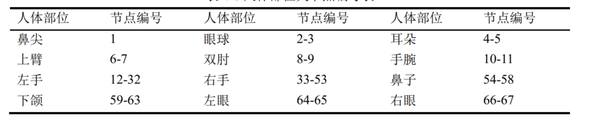
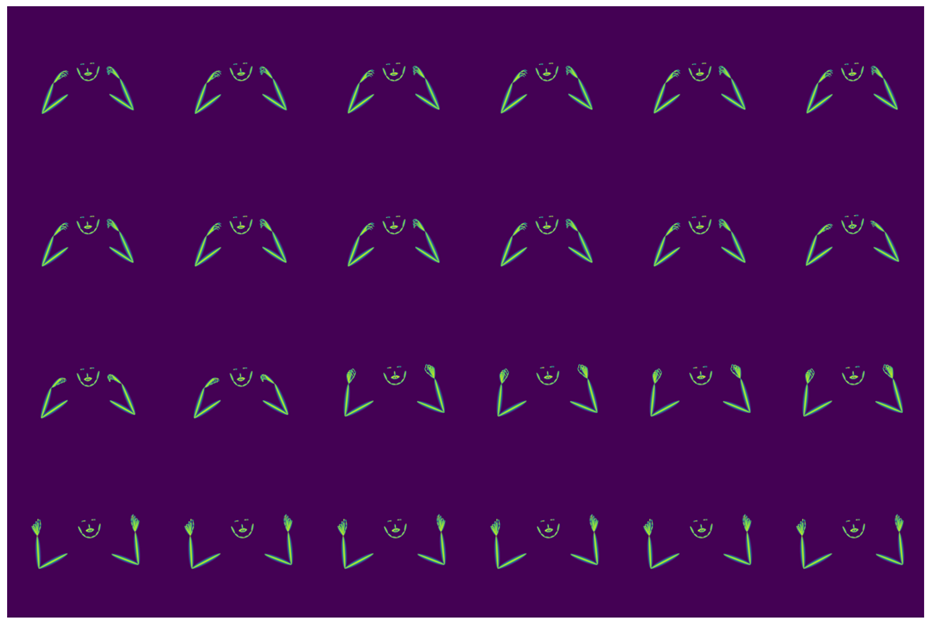
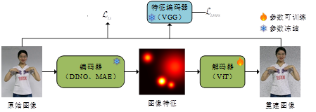
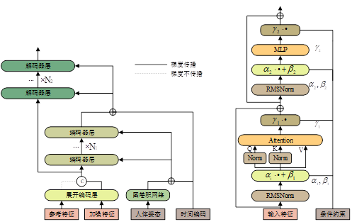
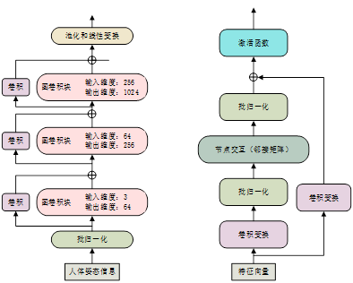

# Pose_Guidance_ISLP

Pose-conditioned isolated sign video generation with a representation autoencoder and flow matching. Given a reference image of a signer and a sequence of body, hand, and facial keypoints, this project generates frames that follow the supplied poses while using the reference image to guide appearance. The generated frames are assembled into a video.

## Technical report

**Adapting Representation-Autoencoder Flow Matching for Pose-Conditioned Isolated Sign Video Production: A Technical Report**

Che Xiao · 12 October 2026

**[Read the full paper (PDF)](report/ISLP_paper.pdf)**

The report documents the implementation, WLASL and SLR500 training artifacts, WLASL evaluation summaries, and the observed trade-off between pose agreement and appearance under classifier-free guidance. It is an implementation record and bounded analysis, rather than a state-of-the-art comparison.

| Evaluation in the report | Metric | Reported value |
| --- | --- | ---: |
| WLASL image reconstruction | FID | 12.46 |
| WLASL image reconstruction | SSIM | 0.92 |
| WLASL frame generation, averaged over 100 clips | SSIM | 0.494 |
| WLASL frame generation, averaged over 100 clips | PSNR | 11.454 dB |

Reconstruction and generation measure different tasks, so their scores should not be compared directly. The generation results reflect the difficulty of framewise synthesis and background mismatch. The report does not evaluate sign-language semantic correctness or establish temporal consistency.

## Method

1. **Extract pose conditions.** HRNet with the DARK detector extracts 67 keypoints covering the upper body, hands, and face.
2. **Learn an image representation.** A frozen DINOv2-B encoder and a trained ViT decoder form the representation autoencoder.
3. **Generate conditioned frames.** A DDT-style transformer predicts a latent velocity field with flow matching. Reference-image prefix tokens participate in self-attention; a graph encoder converts the keypoints into pose conditions.
4. **Assemble the video.** Euler integration samples each frame, and the frames are placed in temporal order. The model generates frames separately and has no temporal module.

<p align="center">
  
</p>
<p align="center">
  
</p>
<p align="center">
  
</p>
<p align="center">
  
</p>
<p align="center">
  
</p>

## Getting started

The project recommends PyTorch >= 2.3, CUDA >= 11.8, and Transformers. The training setup is designed for a single NVIDIA RTX 4090 using LoRA where applicable. Configure the dataset and checkpoint paths in the relevant files under `re_flow/config/` before running the scripts.

### Train

```bash
# Stage 1: representation autoencoder
python re_flow/train_RAE.py

# Stage 2: conditional flow model
python re_flow/train.py
```

### Inference

```bash
python re_flow/sample.py
```

## Scope and limitations

This project starts from a supplied keypoint sequence and reference image. It does not translate text into sign language or predict the keypoint sequence. In the report's displayed classifier-free guidance examples, stronger guidance improves pose agreement while larger scales can reduce appearance fidelity; these observations do not define a universal guidance setting. See the [technical report](report/ISLP_paper.pdf) for experimental details and interpretation.

## Acknowledgment

This project builds on [Representation Autoencoders](https://arxiv.org/abs/2510.11690) and its [open-source implementation](https://github.com/bytetriper/RAE). We thank the authors for their contributions.
